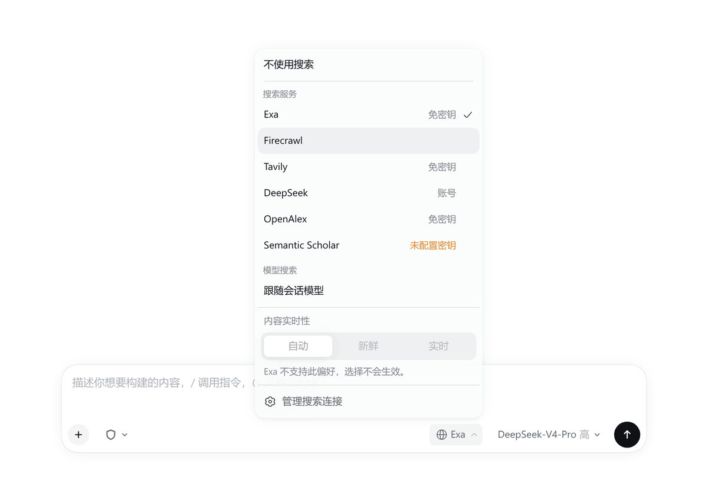
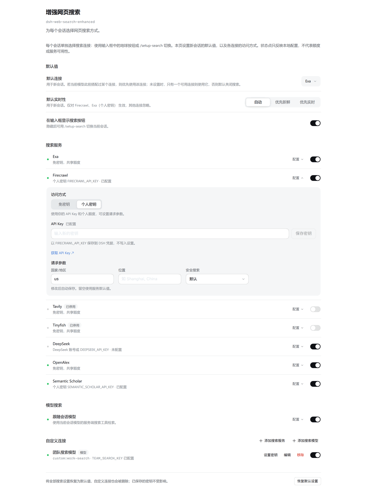

<div align="center">


# Web Search Enhanced

**为每个会话选择网页搜索方式：免密钥起步，也可以用自己的密钥、DeepSeek 搜索或模型自带的搜索。**

[](https://github.com/Yurzi/dsh-web-search-enhanced/releases)
[](LICENSE)
[](package.json)
[](package.json)

</div>

dsh-web-search-enhanced 是 [DeepSeek Harness (DSH)](https://github.com/deepseek-ai/deepseek-harness) 的插件。它接管 DSH 原生的 `web_search` 工具，让每个会话独立选择搜索连接和内容实时性；对话模型和工具调用方式都不变，`web_fetch` 也不受影响。

## 特性

- **装好就能搜**：默认使用 Exa 免密钥搜索；Firecrawl、Tavily、Tinyfish、OpenAlex 同样免密钥可用。
- **按会话选择**：在输入框的地球按钮或 `/setup-search` 中切换，每个会话记住自己的连接和实时性，fork 出的会话之后独立变化。
- **记住模型的搭配**：在某个模型下选过的连接，会成为该模型新会话的默认选择。
- **多种来源**：网页搜索服务、学术检索（OpenAlex、Semantic Scholar）、DeepSeek 搜索（账号登录或 API Key）、固定的搜索模型，或跟随当前会话模型。
- **内容实时性**：自动 / 优先新鲜 / 优先实时，Firecrawl 和 Exa（个人密钥）会据此请求较新的页面内容。
- **密钥安全**：密钥只存放在 DSH 凭据中，设置里只保存引用名；免密钥连接从不发送你的密钥。
- **原生界面**：使用 DSH 的组件和主题，支持深色模式和窄屏，中英文界面。

## 截图

输入框中的搜索菜单：

<p align="center">
  
</p>

<p align="center"><sub><a href="docs/assets/selector-dark.png">深色模式</a> · <a href="docs/assets/selector-narrow.png">窄屏</a> · <a href="docs/assets/selector-not-ready.png">所选连接缺少密钥</a></sub></p>

插件设置页：

<p align="center">
  
</p>

<p align="center"><sub><a href="docs/assets/settings-dark.png">深色模式</a> · <a href="docs/assets/settings-narrow.png">窄屏</a> · <a href="docs/assets/settings-editor.png">添加自定义连接</a></sub></p>

## 安装

要求 DSH `>=0.2.1-rc.2 <0.3.0`，Node.js `^22.19.0 || >=24.0.0`。

从 npm 安装：

```sh
dsh plugin --profile web add dsh-web-search-enhanced@0.1.10
```

或安装本地构建的包（例如用 `pnpm pack` 生成），路径需为绝对路径：

```sh
dsh plugin --profile web add /absolute/path/to/dsh-web-search-enhanced-0.1.10.tgz
```

也可以在 Web 界面的 **插件** 页安装第三方插件时填入包名 `dsh-web-search-enhanced`。安装后刷新 Web 页面。

**升级**：DSH 默认开启热更新（HMR），这时不能在已安装的版本上直接再装一次，需要先卸载再安装：在插件页卸载本插件后重新安装，或执行 `dsh plugin --profile web remove dsh-web-search-enhanced` 后再 `add`。设置、密钥和各会话的选择都会保留。从 0.1.8 及更早版本升级前请先阅读[升级指南](docs/upgrading.md)。

## 快速上手

1. 新建一个会话，直接提问，例如「搜索 TypeScript 最新版本的发布说明，总结主要变化并附上来源」。新会话默认使用 **Exa** 免密钥搜索。
2. 想换连接或实时性：点输入框右侧的地球按钮，或输入 `/setup-search`。选择只作用于当前会话。缺少密钥的连接会注明原因，点击它可直接打开设置页。
3. 想配置密钥、默认连接或自定义连接：打开 **插件 → 已安装插件 → 增强网页搜索**，或在搜索菜单底部点「管理搜索连接」。

## 搜索连接一览

| 连接 | 访问方式 | 内容实时性 | 说明 |
| --- | --- | --- | --- |
| Exa（默认） | 免密钥 / 个人密钥 | 仅个人密钥 | 语义检索，个人密钥时返回页面正文片段，可选搜索类型 |
| Firecrawl | 免密钥 / 个人密钥 | 两种方式都支持 | 可按国家、位置筛选；非自动模式下返回新抓取的正文 |
| Tavily | 免密钥 / 个人密钥 | — | 可选搜索深度和主题（通用、新闻、财经） |
| Tinyfish | 免密钥 / 个人密钥 | — | 可按地区、语言筛选；学术论文类型需要个人密钥 |
| DeepSeek | DeepSeek 账号登录，或 `DEEPSEEK_API_KEY` | — | 使用 DeepSeek 账号登录的会话直接用账号；其他会话使用 API Key（与 DSH「模型」页共用） |
| OpenAlex | 免密钥 / 个人密钥 | — | 开放学术图谱，附作者、引用数、开放获取链接和摘要 |
| Semantic Scholar | 仅个人密钥 | — | 学术检索，附 TL;DR、引用数和开放获取 PDF |
| 自定义搜索服务 | 个人密钥 | 同所用服务 | 复用以上任一服务的接口格式，可指向团队网关等自定义地址 |
| 固定搜索模型 | 个人密钥 | — | 通过 Anthropic Messages、OpenAI Responses 或 Chat Completions 的服务端搜索工具检索 |
| 跟随会话模型 | 会话模型的密钥 | — | 用当前会话的模型搜索；provider 配置需写明 `api`，不支持 OAuth 和订阅登录 |

免密钥连接使用服务的公共接口，额度与其他用户共享，可能因网络或高峰被拒绝或限流。完整的参数、地址和规则见[配置参考](docs/configuration.md)。

## 内容实时性

搜索菜单中的「内容实时性」按会话保存：

- **自动**：使用服务的默认行为，最快。
- **优先新鲜**：优先使用 24 小时内的缓存内容。
- **优先实时**：重新抓取页面，适合刚发生的新闻、行情等。

只有 Firecrawl 和 Exa（个人密钥）会据此调整请求；选中其他连接时，菜单中的实时性选项不可用。实时性控制的是内容缓存，不是按发布日期筛选；越新的内容通常越慢、消耗越多额度。

## 密钥与凭据

在设置页对应服务的配置中填入密钥并保存，密钥写入 DSH 凭据（例如 `EXA_API_KEY`），不会出现在设置文件里。保存密钥后还需把该服务的访问方式切换为个人密钥，插件不会自动切换。

DSH 0.2.1 起，凭据存储中的值优先于环境变量。如果你习惯用环境变量提供密钥，而凭据存储中已有同名的旧值，环境变量不会生效。

## 常见问题

### 搜索报 WEB_SEARCH_NOT_SELECTED

当前会话在搜索菜单中选择了「不使用搜索」。点输入框的地球按钮或输入 `/setup-search`，选择一个连接即可。新会话的默认连接可在设置页修改。

### 免密钥搜索失败或被限流

`WEB_KEYLESS_UNAVAILABLE` 表示服务拒绝了来自你所在网络的匿名访问，`WEB_PROVIDER_RATE_LIMITED` 表示限流。先在菜单里换一个免密钥连接；经常遇到时，为常用服务配置个人密钥并切换访问方式。

### 保存了密钥，搜索仍然是免密钥

保存密钥不会改变访问方式，这是为了避免意外消耗付费额度。在设置页该服务的配置中把访问方式切换为个人密钥。

### 修改会影响其他会话吗？fork 出的会话呢？

不会。每个会话单独保存连接和实时性。fork 出的会话第一次使用时继承父会话当时的选择，之后两边各自修改，互不影响。

### 窗口很窄时，搜索按钮只剩一个图标

输入栏空间不足时，按钮先隐藏实时性，再隐藏连接名，最后只保留地球图标，点开后的菜单不变。也可以随时用 `/setup-search` 切换。按钮只有在设置中关闭「在输入框显示搜索按钮」时才会完全隐藏。

### 能和 dsh-web-fetch-enhanced 一起安装吗？

可以，两种安装顺序都行。两个插件各自占用 DSH 原生 provider 的 ID（本插件是搜索的 `deepseek-official`，dsh-web-fetch-enhanced 是抓取的 `http`），只停用被替换的原生条目，都不改动共享的 `web` 条目。用 `dsh --profile web --dump-config` 检查时，`web` 条目应保持 `searchProvider: deepseek-official` 和 `fetchProvider: http`。

### 内置的“网页搜索”设置页不见了，或搜索没有使用所选连接

本插件替换了 DSH 自带的 DeepSeek 搜索（`web-search-deepseek`），所以 **插件 → 内置插件配置 → 网页搜索** 页面不再显示。DeepSeek 搜索可以改用本插件的 DeepSeek 连接；确实要保留原生搜索时，见[配置参考的共存说明](docs/configuration.md#provider-id-与原生搜索共存)。

`web_search` 没有经过本插件时，插件设置页顶部会提示原因和改法。

如果以前在那个页面打开过「启用新版 Web 搜索 API」，用户配置的 `web` 条目中会残留 `searchProvider: deepseek-search-api` 和 `fetchProvider: deepseek-fetch-api`：搜索和抓取都由 DeepSeek Search / Fetch API 完成，本插件和抓取插件都不参与，输入框中选择的连接不生效。用 `dsh --profile web --dump-config` 查看 `web` 条目，删除用户层中的这两个字段即可。

### 跟随会话模型报 WEB_SEARCH_FOLLOW_UNSUPPORTED

插件无法从模型配置推导出搜索路由，错误信息会写明缺少什么。最常见的原因是 provider 配置没有写 `api`。DSH 自带的 DeepSeek 路由不支持跟随，请改用 DeepSeek 连接。规则见[配置参考](docs/configuration.md#跟随会话模型)。

## 文档

| 文档 | 内容 |
| --- | --- |
| [配置参考](docs/configuration.md) | 所有字段、内置连接、参数白名单、自定义连接、跟随模型规则、错误码 |
| [升级指南](docs/upgrading.md) | 版本对应关系、升级到 0.1.10 的变化、旧配置迁移、回退 |
| [架构](docs/architecture.md) | 模块划分、请求流程、如何新增搜索服务 |
| [开发](docs/development.md) | 本地开发、测试、在真实 DSH 中验证、发布 |
| [更新日志](CHANGELOG.md) | 各版本的变化 |
| [AGENTS.md](AGENTS.md) | 给编码代理的仓库说明（英文） |

## 开发

```sh
pnpm install
pnpm run check
```

详见[开发指南](docs/development.md)。

## 许可与致谢

- 代码以 [MIT](LICENSE) 许可发布。
- 感谢 [DeepSeek Harness](https://github.com/deepseek-ai/deepseek-harness) 团队，以及 Exa、Firecrawl、Tavily、Tinyfish、OpenAlex、Semantic Scholar 等服务。
- **关于横幅形象**：Banner 中的 DeepSeek 鲸鱼娘形象来源于 **上善无形原创角色与 ZipZipPipe 二创**；本项目横幅基于用户提供的参考图经 AI 辅助创作。角色与参考作品的著作权利均归原作者所有，不因本项目代码的 MIT 许可而获得再授权，亦不代表官方背书。

问题反馈请到 [GitHub Issues](https://github.com/Yurzi/dsh-web-search-enhanced/issues)，附上 DSH 与插件版本；不要粘贴密钥或私密对话。
